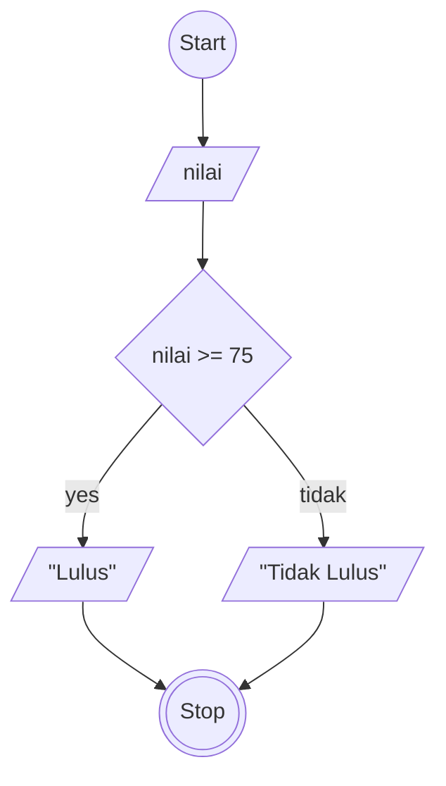

# Tugas Algoritma Bebas
## Algoritma Menentukan Lulus atau Tidak Lulus Siswa
Seorang guru ingin menentukan lulus atau tidaknya mahasiswa dengan syarat jika nilai siswa yang ia didik diatas atau sama dengan 75 makan siswa yang dinilai akan dinyatakan lulus jika nilai siswa dibawah 75 akan dinyatakan tidak lulus.

### Analisis
- Variable: nilai
  
### Algoritma Deskriptif
1. Mulai
2. Tentukan nilai siswa
3. Apabila siswa memiliki nilai diatas atau sama dengan 75 maka siswa tersebut dinyatakan LULUS
4. Apabila siswa memiliki nilai dibawah 75 maka siswa tersebut dinyatakan TIDAK LULUS
5. Selesai

### Algoritma Flowchart


### Pseudo-code
```
DECLARE nilai : INTEGER
INPUT nilai
IF nilai >= 75 THEN
    OUTPUT "Lulus"
ELSE
    OUTPUT "Tidak Lulus"
ENDIF
```
